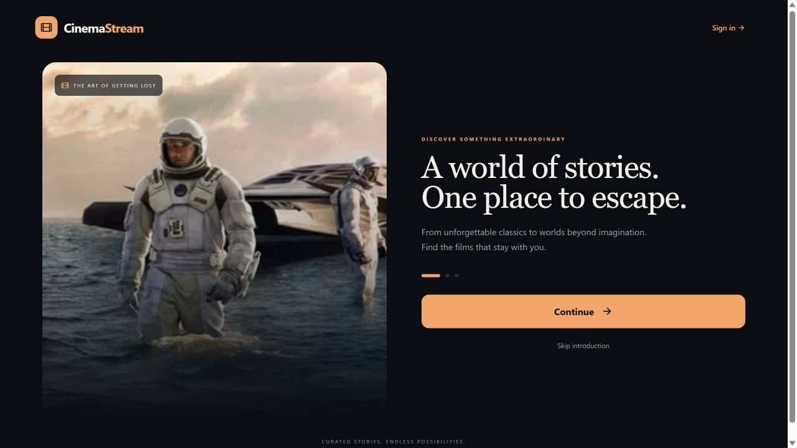
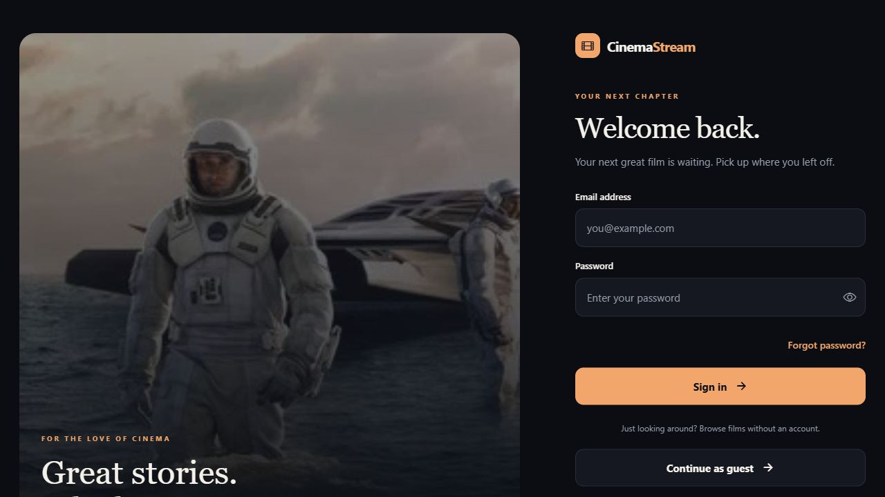
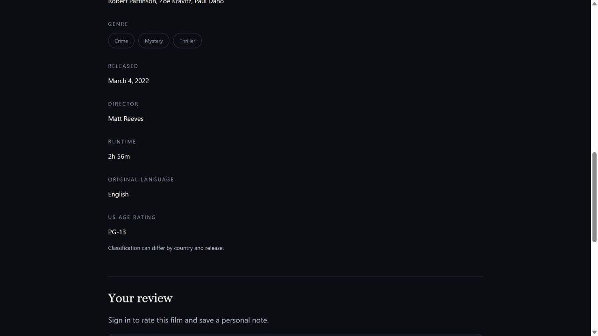
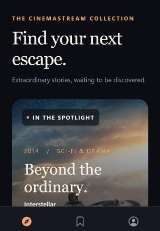
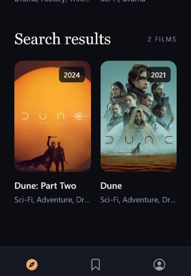
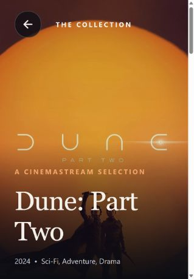
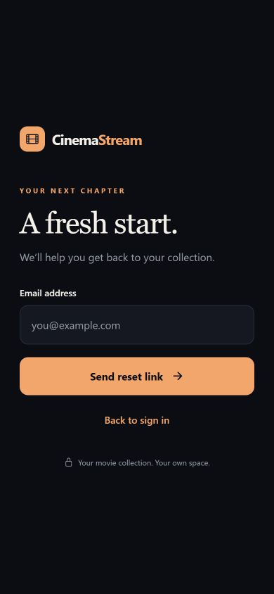

# CinemaStream screenshots

Screenshots of the CinemaStream web prototype for project previews and portfolio case studies. Download the original JPG files rather than copying a scaled preview.

## Desktop

### Welcome

### Sign in and guest access

### Film information

## Mobile

| Discovery | Search results | Film details | Password recovery |
| --- | --- | --- | --- |
|  |  |  |  |

## Using these in a portfolio

- Use `welcome-desktop.jpg` as the project cover and `login-desktop.jpg` to show the desktop layout.
- Use the discovery, search and film mobile images together to show the browsing flow.
- Keep the original aspect ratios. These are screenshots, not device mockups or native app build captures.
- Suggested alt text is included above; retain useful alt text when adding images to a portfolio.
- Link to this gallery for the complete set, or download the JPG files for a portfolio's own image folder.

The mobile discovery, search and film images were captured from the local Docker prototype on 22 October 2026. Desktop and recovery images are earlier prototype captures. The gallery documents local prototype screens; it does not establish that every pictured feature has been deployed publicly or released in the main branch.

No account emails, passwords, private reviews or credentials are shown. Movie artwork belongs to its respective rights holders; inclusion in a screenshot does not grant a separate license to that artwork. CinemaStream is a movie discovery and collection prototype, not a full-film streaming service.
